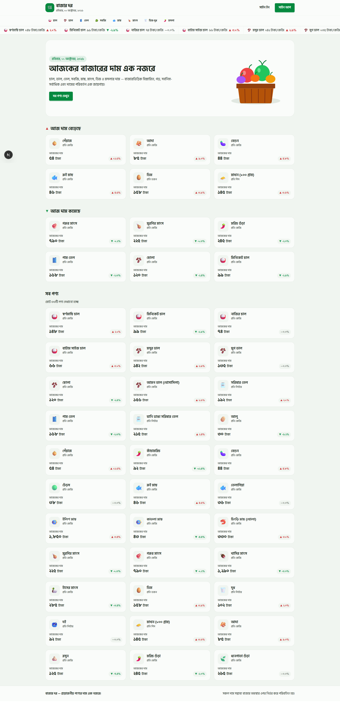
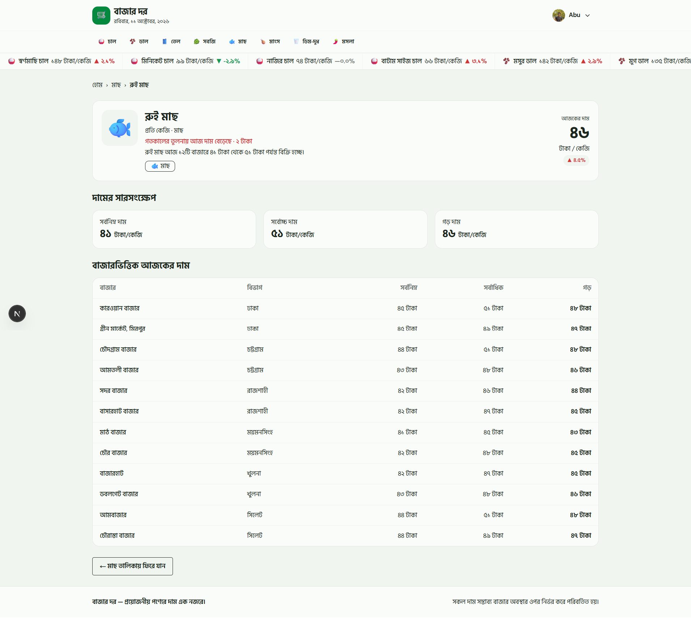

<div align="center">

# 🛒 বাজার দর · BazarDor

**প্রয়োজনীয় পণ্যের দাম এক নজরে।**

*Track today's essential grocery prices across Bangladesh — in Bangla, at a glance.*

[](https://bazar-dor-beta-orpin.vercel.app/)
[](https://nextjs.org)
[](https://www.typescriptlang.org)
[](https://tailwindcss.com)

</div>

---

## 📖 পরিচিতি | About

**বাজার দর (BazarDor)** একটি বাংলা ওয়েব অ্যাপ, যেখানে চাল, ডাল, তেল, সবজি, মাছ, মাংস, ডিম-দুধ ও মসলার **আজকের দাম**, **দামের ওঠানামা** এবং **বিভিন্ন বাজারের তুলনামূলক দাম** এক জায়গায় দেখা যায়। ক্রেতারা কেনাকাটার আগে সহজেই বুঝতে পারেন কোন পণ্যের দাম বাড়ছে, কোনটার কমছে, আর কোন বাজারে কত দামে পাওয়া যাচ্ছে।

**BazarDor** is a Bangla-first web app that shows today's prices of everyday essentials, how they changed since yesterday, and a market-by-market price breakdown across divisions.

🔗 **Live site:** [https://bazar-dor-beta-orpin.vercel.app/](https://bazar-dor-beta-orpin.vercel.app/)

<!--
স্ক্রিনশট যোগ করতে: docs/ ফোল্ডারে ছবি রেখে নিচের লাইনগুলোর <!-- --> সরিয়ে দিন
<p align="center">
  
  
</p>
-->

---

## ✨ ৫টি মূল ফিচার | Key Features

| # | ফিচার | বিবরণ |
|---|-------|--------|
| 1 | 📈 **লাইভ প্রাইস টিকার** | পেজের উপরে অবিরাম চলতে থাকা স্ক্রলিং স্ট্রিপে প্রতিটি পণ্যের দাম ও ▲/▼ পরিবর্তন (হোভার করলে থামে) |
| 2 | 🔺🔻 **আজ কী বাড়ল, কী কমল** | সবচেয়ে বেশি দাম বাড়া ও কমা শীর্ষ ৬টি পণ্য আলাদা সেকশনে, সাথে সব পণ্যের রেসপন্সিভ গ্রিড |
| 3 | 🗂️ **ক্যাটাগরি পেজ ও সর্টিং** | ক্যাটাগরি অনুযায়ী পণ্য দেখা এবং দাম অনুযায়ী (কম→বেশি / বেশি→কম) সংখ্যাভিত্তিক সর্টিং, লোডিং স্কেলিটন ও এম্পটি স্টেট সহ |
| 4 | 🔐 **নিরাপদ অথেন্টিকেশন** | ইমেইল-পাসওয়ার্ড, **Google** ও **GitHub** দিয়ে সাইন ইন/সাইন আপ; টোস্ট নোটিফিকেশন ও প্রোটেক্টেড রুট |
| 5 | 🏪 **বাজারভিত্তিক বিস্তারিত দাম** | লগইন করলে প্রতিটি পণ্যের সর্বনিম্ন, সর্বোচ্চ ও গড় দাম এবং বিভাগ অনুযায়ী বিভিন্ন বাজারের দামের টেবিল |

**অতিরিক্ত বৈশিষ্ট্য:** বাংলা সংখ্যা ও বাংলা তারিখ · মোবাইল/ট্যাবলেট/ডেস্কটপে সম্পূর্ণ রেসপন্সিভ · ফ্রেন্ডলি ৪০৪ পেজ · রিলোডে কোনো এরর নেই

---

## 🛠️ ব্যবহৃত প্রযুক্তি | Tech Stack

| ক্ষেত্র | প্রযুক্তি |
|---------|-----------|
| **Framework** | [Next.js 16](https://nextjs.org) (App Router) |
| **Language** | [TypeScript](https://www.typescriptlang.org) |
| **Styling** | [Tailwind CSS v4](https://tailwindcss.com) + [DaisyUI](https://daisyui.com) |
| **Authentication** | [Better Auth](https://better-auth.com) (Email/Password, Google, GitHub) |
| **Database** | [MongoDB Atlas](https://www.mongodb.com/atlas) |
| **Notifications** | [react-hot-toast](https://react-hot-toast.com) |
| **Icons** | [Lucide React](https://lucide.dev) |
| **Font** | Hind Siliguri (Google Fonts) |
| **Deployment** | [Vercel](https://vercel.com) |

---

## 🗺️ রুট | Routes

| পথ | বিবরণ | সুরক্ষিত |
|----|--------|:--------:|
| `/` | হোম: হিরো, দাম বাড়া/কমা, সব পণ্য | — |
| `/category/[slug]` | ক্যাটাগরি অনুযায়ী পণ্য ও সর্টিং | — |
| `/product/[slug]` | পণ্যের বিস্তারিত ও বাজারভিত্তিক দাম | 🔒 |
| `/signin` · `/signup` | লগইন ও রেজিস্ট্রেশন | — |
| `/profile` | আমার প্রোফাইল ও তথ্য আপডেট | 🔒 |

---

## 🚀 লোকালি চালানোর নিয়ম | Getting Started

**১. রিপোজিটরি ক্লোন করুন**

```bash
git clone https://github.com/abukausar-dev/bazar-dor.git
cd bazar-dor
```

**২. ডিপেন্ডেন্সি ইনস্টল করুন**

```bash
pnpm install
```

**৩. `.env.local` ফাইল বানান**

```bash
NEXT_PUBLIC_API_URL=https://api.abcz.workers.dev/api/bazardor
BETTER_AUTH_SECRET=your-random-secret
BETTER_AUTH_URL=http://localhost:3000
MONGODB_URI=your-mongodb-connection-string
GOOGLE_CLIENT_ID=your-google-client-id
GOOGLE_CLIENT_SECRET=your-google-client-secret
GITHUB_CLIENT_ID=your-github-client-id
GITHUB_CLIENT_SECRET=your-github-client-secret
```

**৪. ডেভেলপমেন্ট সার্ভার চালু করুন**

```bash
pnpm dev
```

এরপর ব্রাউজারে [http://localhost:3000](http://localhost:3000) খুলুন।

---

## 📁 প্রজেক্ট কাঠামো | Project Structure

```text
src/
├── app/                  # রুট ও পেজ (App Router)
│   ├── api/auth/         # Better Auth হ্যান্ডলার
│   ├── category/[slug]/  # ক্যাটাগরি পেজ
│   ├── product/[slug]/   # সুরক্ষিত বিস্তারিত পেজ
│   ├── signin/ signup/   # অথেন্টিকেশন পেজ
│   └── profile/          # প্রোফাইল
├── components/           # রিইউজেবল কম্পোনেন্ট (layout, home, product, auth, details)
├── lib/                  # API, অথ, ফরম্যাটার (বাংলা সংখ্যা/তারিখ), সর্টিং
├── types/                # TypeScript টাইপ
└── proxy.ts              # প্রোটেক্টেড রুটের জন্য প্রক্সি
```

---

## 🙋 লেখক | Author

**Kausar** — Programming Hero, Batch 14 · Assignment 07

শিক্ষামূলক প্রজেক্ট হিসেবে তৈরি। সব দাম সম্ভাব্য; বাজার অবস্থার ওপর নির্ভর করে পরিবর্তিত হয়।